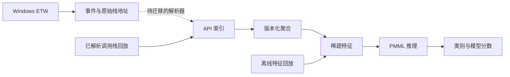

# Windows ETW Behavior Detection

**Windows ETW 行为采集、调用栈特征提取与随机森林分类研究工程。**

本仓库将作者两个原创 ETW 研究项目的核心方法整理为公开实现，包含独立 Java 推理、两版 C++ 特征聚合、Windows 原始事件采集和实验工具。构建验证由 [GitHub Actions](https://github.com/Shmily1368/etw-behavior-detection/actions/workflows/verify.yml) 执行，可以下载 CI 产物，无需先在个人电脑搭建完整环境。

已通过[云端构建与回放](https://github.com/Shmily1368/etw-behavior-detection/actions/runs/40999275593)：Java 11 编译、重复推理、C++ 特征契约、Windows x64 编译。首次 Windows 托管构建使用 Visual Studio 18 2026 / MSVC 19.51。

## 当前状态

| 能力 | 公开版范围 |
|---|---|
| 特征到推理 | 独立 CLI、原始模型/字典、版本与哈希检查 |
| 调用栈特征聚合 | 保留旧 API 分组与新版逐栈频次两种语义 |
| Windows ETW | 进程、线程、镜像事件和可选原始调用栈地址 |
| 地址到 API 解析 | 完整解析链路尚待迁移，不声称实时端到端检测完成 |
| 实验与样例 | 合成契约样例、内容大小测量、模拟客户端调度 |
| 真实效果 | 真实采集、训练流程和准确率尚未在公开版验证 |

## 技术链路



原始 API 字典含 2,863 个有序条目；随机森林 PMML 包含 100 棵树、950 个 `xN` 特征字段。字段使用完整空间的子集，`xN` 对应数组 `N-1` 元素。不能改变字典顺序后继续沿用原模型。

旧实现按 API 分组累计，新实现逐调用栈累计，维度相同不能证明模型兼容。默认推理只接受旧聚合候选版本；新版必须显式使用实验选项。旧实现的尾部分组未提交行为也保留并通过固定契约验证。

## 离线运行

构建、命令和产物路径见[英文 README](README.md)。主要步骤：

```bash
mvn --batch-mode -f detector/pom.xml verify
mkdir results
java -jar detector/target/etw-behavior-detector-0.1.0.jar \
  --input examples/features.ndjson --output results/predictions.ndjson \
  --model models/random_forest.pmml --dictionary models/API.csv \
  --manifest models/manifest.json
```

提供的输入是明确标记的合成软件契约样例，用于验证索引、聚合和推理流程，不能作为攻击检出或准确率证据。模型失败、维度错误、字典不一致均返回错误，结果不会被解释为「正常」。

[样例预期输出](examples/expected-predictions.json)来自已成功的云端运行，用作回归基线，类别并非样例的真实行为标注。

Windows 二进制由 CI 编译。实机使用需要管理员终端，短时采集可与良性工作负载脚本配合；当前输出保留原始地址，完整符号解析与模型集成仍待验证。

## 文档

[架构](docs/architecture.md)、[方法](docs/methodology.md)、[模型卡](docs/model-card.md)、[实验协议](docs/experiments.md)、[Windows 采集范围](docs/windows-collector.md)、[局限](docs/limitations.md)、[来源](docs/provenance.md)。

模型输出是行为类别，不能单独判定恶意；分数也未证明为校准后的恶意概率。没有发布未知的精度和性能收益。

作者：Shmily1368。项目采用 AGPL-3.0-only，保留 JPMML 推理依赖，公开构建不包含 ClamAV 或原企业后端。详见 [LICENSE](LICENSE) 与 [NOTICE](NOTICE)。
